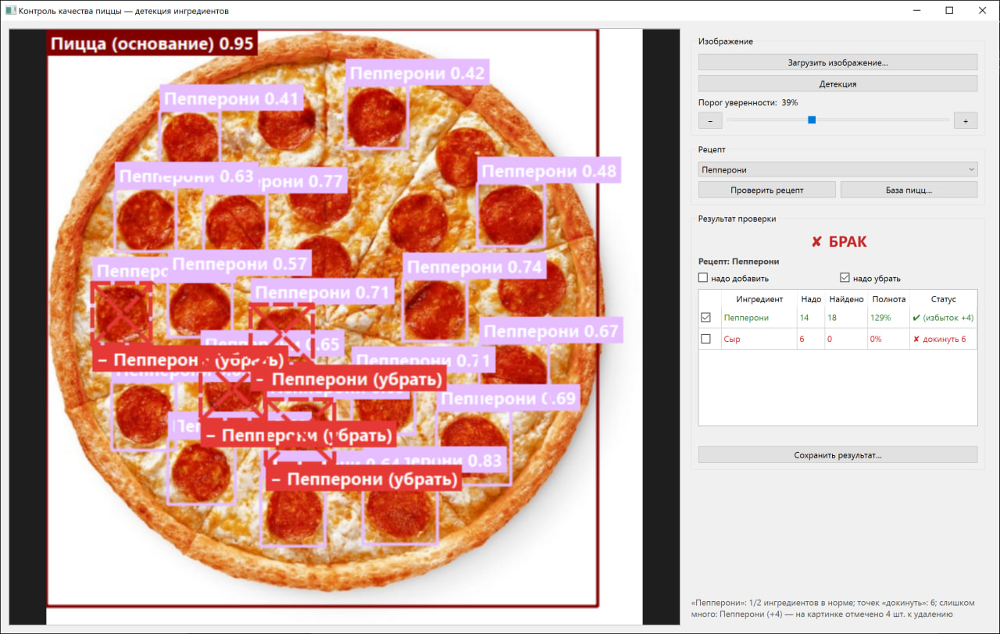

# Pizza Quality Control — контроль качества пиццы компьютерным зрением

Семестровый проект по дисциплине «Компьютерное зрение» (Спиридонов Н., Хисматуллина М.).

Система детектирует ингредиенты на фотографии пиццы (YOLOv8), сверяет их с рецептом
из базы пицц и выносит вердикт: всё ли совпало. Если какого-то ингредиента не хватает
(полнота < 90%), приложение показывает, **куда докинуть** недостающие кусочки —
в точки, наиболее удалённые от уже лежащих ингредиентов того же класса.

## Возможности

- **Детекция** — дообученная YOLOv8n находит 16 классов (15 ингредиентов + сама пицца),
  обводит каждый ингредиент цветной рамкой с классом и уверенностью.
- **База пицц** — редактируемые рецепты: для каждой пиццы указано требуемое количество
  каждого ингредиента (`data/pizzas.json`).
- **Валидация** — по каждому ингредиенту: надо / найдено / полнота в %. Зелёная галочка —
  только при точном совпадении; недостача и избыток — красные крестики (✘ докинуть /
  ✘ избыток), полнота 90–99% — жёлтое «≈». Вердикт PASS, если у всех ингредиентов
  полнота ≥ 90% (избыток на вердикт не влияет, но помечается в таблице и крестами
  «убрать» на картинке). Лишние ингредиенты (нет в рецепте) — строки таблицы
  с «Надо = 0» и статусом «лишний».
- **Подсказки «куда докинуть»** — мишени на изображении. Экземпляры того же класса
  есть: точки максимально удалены от них. Класса нет вовсе (например, сыр):
  равномерное покрытие всей пиццы (спираль Вогеля).
- **Эксперименты** — обучение полностью параметризовано, каждый запуск сохраняет метрики
  в `runs/<имя>/results.csv`, сводная таблица всех экспериментов строится одной командой.

## Структура проекта

```
├── download_dataset.py   # скачивание датасета с HuggingFace → dataset/
├── train.py              # дообучение YOLOv8 (все параметры через CLI)
├── evaluate.py           # метрики на тестовой выборке → metrics/
├── compare_runs.py       # сводная таблица экспериментов (этап 4)
├── detector.py           # обёртка модели → детекции
├── recipes.py            # база пицц (JSON) + русские названия классов
├── validator.py          # валидация рецепта + алгоритм «куда докинуть»
├── app.py                # оконное приложение (PyQt6)
├── test_validator.py     # тесты логики валидации
├── data/pizzas.json      # база пицц
└── weights/              # обученные веса (best.pt)
```

## Установка

Нужен Python 3.10+.

```bash
python -m venv .venv
.venv\Scripts\activate

# Вариант A — машина без NVIDIA (инференс, GUI, смоук-тесты):
pip install torch torchvision --index-url https://download.pytorch.org/whl/cpu

# Вариант B — машина с NVIDIA GPU (обучение):
# см. https://pytorch.org/get-started/locally/ и поставьте CUDA-сборку torch

pip install -r requirements.txt
```

## Использование

### 1. Датасет

```bash
python download_dataset.py
```

Скачивает [Pizza-Toppings-Object-Detection](https://huggingface.co/datasets/mbar0075/Pizza-Toppings-Object-Detection)
(~90 МБ) в `dataset/` и создаёт корректный `dataset/data.yaml`.
Реальное содержимое репозитория: **300 уникальных изображений** (по 100
train/valid/test, 5680 размеченных экземпляров ингредиентов) — это подмножество
исходного [Pizza Object Detector (Roboflow Universe)](https://universe.roboflow.com/advanced-computer-vision-assignment/pizza-object-detector/dataset/7)
(3111 изображений), лицензия CC BY 4.0.

Особенность данных: класс **Onion отсутствует в train** (0 экземпляров при 73 в test),
Bacon и Broccoli почти исчезающе редки — это стоит учитывать при анализе метрик
по классам (см. `dataset/class_distribution.csv`).

### 2. Обучение

```bash
python train.py --name exp01_baseline
```

По умолчанию: YOLOv8n, 50 эпох, imgsz 640, batch 16, early stopping (patience 15),
seed 42, `device=auto` (CUDA, если доступна, иначе CPU). Лучшие веса копируются
в `weights/best.pt`. Основные параметры для экспериментов (этап 4):

| Параметр | По умолчанию | Описание |
|---|---|---|
| `--model` | yolov8n.pt | архитектура/размер модели (n / s / m …) |
| `--epochs` | 50 | число эпох |
| `--imgsz` | 640 | размер входа |
| `--batch` | 16 | размер батча (`-1` — авто) |
| `--lr0` | 0.01 | начальный learning rate |
| `--optimizer` | auto | SGD / AdamW / Adam |
| `--mosaic`, `--mixup`, `--hsv_h/s/v`, `--degrees`, `--flipud`, `--fliplr` | — | аугментации |
| `--name` | exp01_baseline | имя эксперимента (`runs/<name>`) |
| `--device` | auto | cuda / cpu / 0 |

### 3. Оценка метрик

```bash
python evaluate.py                # weights/best.pt на тестовой выборке
python evaluate.py --runs all     # все runs/* по очереди
```

Сохраняет в `metrics/<имя>/`: общий mAP@0.5, mAP@0.5:0.95, Precision, Recall
и per-class таблицу (CSV) — готовые таблицы для отчётов по этапам 3–4.

### 4. Сравнение экспериментов (этап 4)

```bash
python compare_runs.py
```

Собирает `runs/*/results.csv` в одну таблицу `metrics/experiments_summary.csv`
и график `metrics/experiments_comparison.png` — меняй параметр, переобучай,
сравнивай и делай выводы.

### 5. Приложение

```bash
python app.py
```

1. «Загрузить изображение» → «Детекция» — ингредиенты в рамках.
2. Выбери пиццу из базы (или отредактируй базу кнопкой «База пицц»).
   Режим «— без рецепта —» просто показывает всё найденное.
3. «Проверить рецепт» — таблица полноты, вердикт и отклонения на картинке:
   маджентовые мишени «куда докинуть» и красные крестики «что убрать»
   (отключаются чекбоксами «надо добавить» / «надо убрать»).
4. Чекбоксы в таблице скрывают классы на изображении, кнопки −/+ и слайдер
   настраивают порог уверенности.
5. «Сохранить результат» — PNG с разметкой.



## Лицензии

- Код проекта — MIT.
- Датасет — [CC BY 4.0](https://creativecommons.org/licenses/by/4.0/) (Roboflow Universe / mbar0075).
